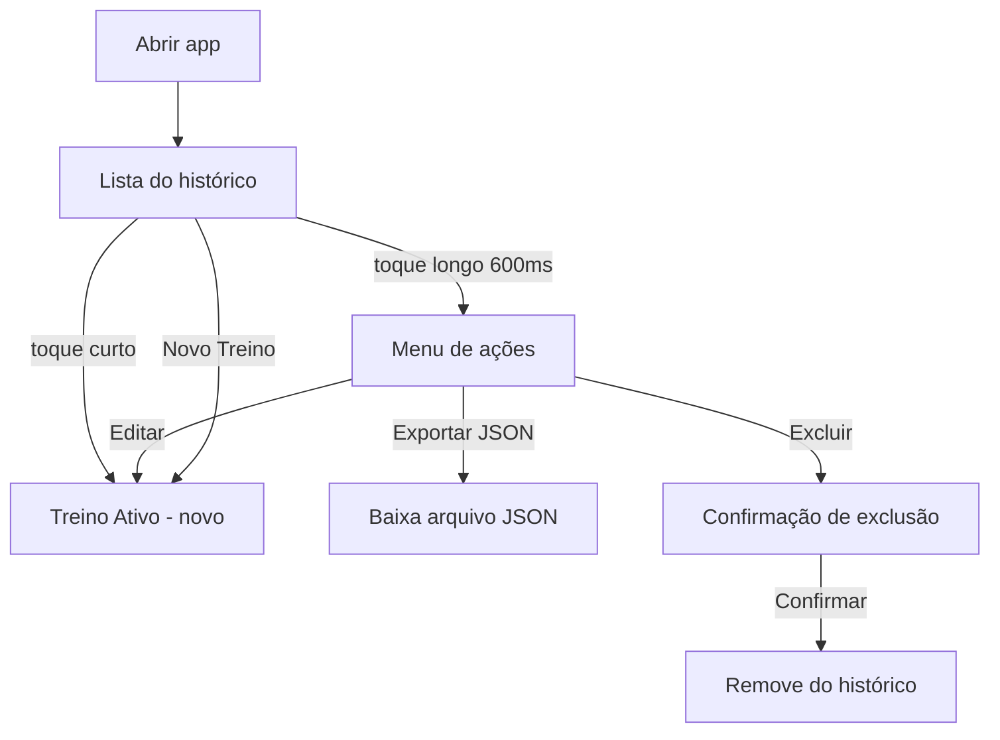

# Histórico

O Histórico é a tela de entrada do Meu Treino. Mostra os treinos concluídos, do mais recente para o mais antigo, e é o ponto de partida para criar, editar, exportar ou excluir treinos.

## Fluxo do usuário



## Como as peças se coordenam (diagrama de camadas)

O código espalha a responsabilidade entre vários arquivos. Este diagrama mostra quem chama quem quando o usuário interage com o Histórico:

```
View (HistoryView.tsx)
  └─ Pura, sem lógica. Recebe dados e callbacks via props de useHistoryView.
      │
      ▼ props + callbacks
Container (useHistoryView.ts)
  └─ Único ponto que une os três contextos especializados nesta tela.
      │ consome
      ├─ HistoryContext (workoutHistory, deleteSession, reloadAllData)
      ├─ SessionContext (startEditingWorkout, startNewWorkout)
      └─ NavigationContext (navigateToHistory, navigateToActiveWorkout)
      │
      ▼ chama quando necessário
Serviço de persistência (storageService.ts)
  └─ Lê e grava diretamente no LocalStorage (chave: meu_treino_history)
```

Essa separação é intencional: nenhum componente recebe props em cascade (prop-drilling é proibido pelo AGENTS.md). Cada camada tem um papel claro e a View nunca sabe que o LocalStorage existe.

## O que você vê ao abrir

Ao abrir o aplicativo, a tela do Histórico é composta por:

- **Cabeçalho**: título "Histórico" e um botão de configurações/backup (ícone de engrenagem). O botão fica vermelho quando existem treinos que ainda não foram salvos em arquivo de backup.
- **Card de treino em andamento** (opcional): aparece no topo quando existe uma sessão com status `in_progress`. Exibe o nome do treino, a data de início e um botão "Retomar" para continuar de onde parou.
- **Lista de treinos concluídos**: cada item exibe apenas três dados:
  - **Nome do treino** (se for "Treino Livre", mostra exatamente isso).
  - **Duração** (ex: "45 min", arredondado de segundos para minutos).
  - **Data e hora** (formato brasileiro, dia/mês/ano hh:mm).
- **Botão flutuante "Novo Treino"**: canto inferior direito, cria um treino em branco e navega para o Treino Ativo.

Não aparecem quantidade de séries nem nomes de exercícios no item da lista — esses detalhes só são vistos ao abrir o treino no Treino Ativo.

## O toque longo e o menu de ações

Um toque curto em um treino leva para a edição no [Treino Ativo](./treino-ativo.md). Se o dedo ficar pressionado por cerca de 600 ms (ou menu de contexto com botão direito), aparece um menu com três opções:

1. **Editar Treino** — abre o treino para edição no Treino Ativo.
2. **Exportar este Treino (JSON)** — baixa um arquivo JSON individual.
3. **Excluir Treino** — inicia confirmação antes de apagar.

Esse comportamento é implementado no `WorkoutHistoryItem`, que mede o tempo do toque:

```tsx
const handleTouchStart = useCallback(() => {
  timerRef.current = window.setTimeout(() => {
    onLongPress(session.id);
  }, 600);
}, [session.id, onLongPress]);
```

Se soltar antes dos 600 ms, o temporizador é cancelado. O menu é um modal simples com botões de ícone (lápis, download, lixeira). A exclusão não acontece imediatamente: surge um diálogo de confirmação com a mensagem "Deseja realmente excluir este treino do histórico? Esta ação não pode ser desfeita."

## Editar um treino: saindo do Histórico

Ao tocar em um treino (ou escolher "Editar" no menu), o container `useHistoryView` inicia a edição e navega para o [Treino Ativo](./treino-ativo.md):

```tsx
const handleSessionTap = useCallback(
  (session: WorkoutSession) => {
    startEditingWorkout(session);
    navigateToActiveWorkout();
  },
  [startEditingWorkout, navigateToActiveWorkout],
);
```

Daí em diante quem comanda é o Treino Ativo. Quando o treino é finalizado, volta para o Histórico como concluído.

## Excluir um treino

A exclusão exige confirmação explícita via `MtConfirmDialog`. Só após confirmar o treino é removido:

```tsx
const confirmDeleteSession = useCallback(() => {
  if (sessionToDeleteId) {
    deleteSession(sessionToDeleteId);
    setSessionToDeleteId(null);
  },
  [deleteSession, sessionToDeleteId],
);
```

A função `deleteSession` chama `deleteWorkoutSession` do serviço de persistência e recarrega a lista do `LocalStorage`.

## Onde os dados moram

Todo o Histórico fica no `LocalStorage` sob a chave `meu_treino_history`. Os dados são serializados como JSON e seguem a estrutura de `WorkoutSession` definida em `src/types/workout.ts`:

```json
{
  "id": "uuid",
  "date": "2026-10-25T15:30:00.000Z",
  "durationInSeconds": 2700,
  "name": "Treino A - Peito",
  "cues": ["lembrar de aquecer ombro"],
  "exercises": [
    {
      "id": "uuid",
      "name": "Supino Reto",
      "weightInKg": 60,
      "notes": "",
      "sets": [
        {
          "weightInKg": 60,
          "repetitions": 10,
          "restTimeInSeconds": 120,
          "advancedTechniques": []
        }
      ],
      "equipmentType": "barbell",
      "loadType": "total"
    }
  ],
  "isTemplate": false,
  "status": "completed"
}
```

Ao carregar a tela, `getWorkoutHistory()` lê essa chave, ordena pelos dados mais recentes primeiro e retorna para a View.

O aplicativo também rastreia o último backup pela chave `meu_treino_last_backup_count`, que guarda quantos treinos existiam no momento da última exportação. Se esse número for menor que o total atual, o botão de configurações no cabeçalho avisa que existem treinos novos ainda não salvos em arquivo.

## Como os dados chegam ao LocalStorage

O fluxo é dividido em três camadas:

**1. Serviço de persistência** (`src/services/storageService.ts`)

É quem lê e escreve diretamente no `LocalStorage`:

```tsx
export function getWorkoutHistory(): WorkoutSession[] {
  const historyJson = localStorage.getItem(HISTORY_STORAGE_KEY); // 'meu_treino_history'
  // ... parse JSON, ordena por data decrescente
}

export function saveWorkoutSession(workoutSession: WorkoutSession): void {
  // atualiza ou insere na lista e grava de volta no LocalStorage
}

export function deleteWorkoutSession(workoutSessionId: string): void {
  // remove pelo id e grava a lista filtrada no LocalStorage
}
```

**2. Contexto de histórico** (`src/hooks/history/HistoryProvider.tsx`)

Coordena as funções e expõe o estado via React Context. Só recarrega os dados quando a view atual é `'history'`:

```tsx
useEffect(() => {
  if (currentView === 'history') {
    setWorkoutHistory(getWorkoutHistory());
  }
}, [currentView]);

const deleteSession = useCallback((sessionId: string) => {
  deleteWorkoutSession(sessionId);
  setWorkoutHistory(getWorkoutHistory());
}, []);
```

**3. Container da View** (`src/views/HistoryView/useHistoryView.ts`)

Consome `useHistory`, `useSession` e `useNavigation`, e expõe uma API declarativa para a View. É o único ponto que une histórico, sessão e navegação nesta tela.

```tsx
const { workoutHistory } = useHistory(); // do HistoryContext
const { startEditingWorkout, startNewWorkout } = useSession(); // do SessionContext
const { navigateToHistory, navigateToActiveWorkout } = useNavigation(); // do NavigationContext
```

## Por que o HistoryProvider só recarrega quando a view é 'history'

No `HistoryProvider.tsx` existe este efeito:

```tsx
useEffect(() => {
  if (currentView === 'history') {
    setWorkoutHistory(getWorkoutHistory());
  }
}, [currentView]);
```

A leitura do `LocalStorage` só acontece quando o usuário está efetivamente na tela do Histórico. Isso evita:

1. **Leituras desnecessárias**: quando o usuário está no Treino Ativo, não há motivo para re-ler a lista de treinos concluídos.
2. **Re-renders indesejados**: toda gravação no LocalStorage dispararia um re-render do HistoryContext se ele estivesse ouvindo sempre, mesmo em outras telas.

O efeito é disparado pela mudança de `currentView` (via `NavigationContext`). Quando o usuário volta do Treino Ativo para o Histórico, `currentView` vira `'history'` e a lista é recarregada, refletindo treinos que foram finalizados ou excluídos enquanto ele estava fora.

## Os dois estados de "exclusão pendente" (e por que existem dois)

O código usa dois estados distintos no `useHistoryView` para o fluxo de exclusão, e isso pode parecer redundante à primeira vista. Não é. Cada um representa uma etapa diferente:

| Estado                      | Significado                                                                          | Quando é preenchido                       | Quando é limpo                                    |
| --------------------------- | ------------------------------------------------------------------------------------ | ----------------------------------------- | ------------------------------------------------- |
| `selectedSessionForActions` | O usuário fez toque longo e está vendo o menu de ações (Editar / Exportar / Excluir) | Toque longo de 600ms confirmado           | Usuário escolhe uma opção do menu ou fecha o menu |
| `sessionToDeleteId`         | O usuário escolheu "Excluir" no menu e agora está no diálogo de confirmação          | Clique em "Excluir Treino" dentro do menu | Usuário confirma ou cancela a exclusão            |

**Por que dois estados?** Porque o toque longo não dispara exclusão direta. Ele abre um menu com três opções. Só se o usuário tocar explicitamente em "Excluir" é que a confirmação de exclusão aparece. Separar os estados evita que o diálogo de confirmação seja aberto acidentalmente enquanto o usuário ainda está decidindo entre editar, exportar ou excluir.

## Fluxo passo a passo: excluir um treino

1. **Toque longo** (ou botão direito): `WorkoutHistoryItem` inicia um timer de 600ms. Se o usuário soltar o dedo antes, o timer é cancelado e nada acontece.
2. **Timer completa**: `onLongPress(session.id)` é chamado no container (`useHistoryView`), que preenche `selectedSessionForActions` e abre o modal de ações.
3. **Usuário escolhe "Excluir Treino"**: `handleDeleteFromActionMenu` preenche `sessionToDeleteId` com o ID da sessão, fecha o menu de ações e fecha o modal.
4. **Diálogo de confirmação**: `MtConfirmDialog` aparece com a mensagem "Deseja realmente excluir este treino do histórico? Esta ação não pode ser desfeita."
5. **Confirma**: `confirmDeleteSession` chama `deleteSession` do `HistoryContext`, que remove do `LocalStorage` e recarrega a lista.
6. **Cancela**: `cancelDeleteSession` limpa `sessionToDeleteId`. Nada é removido.

## Por que o controle de backup usa contagem e não data/hora

O aplicativo rastreia o último backup pela chave `meu_treino_last_backup_count`, que guarda quantos treinos existiam no momento da última exportação. Se esse número for menor que o total atual, o botão de configurações no cabeçalho avisa que existem treinos novos ainda não salvos em arquivo.

**Por que contagem em vez de data/hora?** Simplicidade e robustez offline. Não depende do relógio do sistema, não tem problema com fuso horário e não exige parsing de datas. Basta comparar dois números inteiros.

## Botão de configurações e backup

No cabeçalho da tela existe um botão de configurações e backup. Quando há treinos não salvos em backup, ele fica vermelho. Dentro do modal que ele abre existem três seções:

- **Backup de Treinos** (`BackupSection`): exporta todo o histórico como um único arquivo JSON ou importa um arquivo previamente exportado. Após importação bem-sucedida, volta para o Histórico e recarrega a lista. Usa `exportWorkoutBackup()` e `importWorkoutBackup()` de `src/services/backupService.ts`.
- **Exportar para IA** (`ExportAISection`): gera um resumo em texto filtrado por período (última semana, último mês, últimos 2 ou 3 meses), formatado para ser lido por assistentes de IA. Usa `exportHistoryForAI()` de `src/services/exportAI.ts`.
- **Versão** (`VersionInfo`): mostra a versão atual do app.

## Exportação convencional vs exportação para IA

São duas features com propósitos e implementações diferentes:

**Exportação convencional** (`backupService.ts`): gera um arquivo JSON com todo o histórico. A decisão foi por um único arquivo completo, facilitando backup e restauração integral dos dados do usuário.

**Exportação para IA** (`exportAI.ts`): filtra as sessões por período escolhido e gera um arquivo de texto simples (não JSON). A decisão foi por texto plano porque é mais direto para assistentes de IA lerem e interpretarem, sem a necessidade de navegar em estruturas JSON aninhadas.

## Filosofia de componentização e onde as coisas acontecem

O projeto segue a separação entre componentes de UI (`Mt*`, agnósticos) e componentes de domínio (nomes de treino). No Histórico isso se reflete assim:

- **`HistoryView.tsx`** — View pura. Não tem lógica: recebe todos os dados e callbacks de `useHistoryView` via props. Só renderiza.
- **`WorkoutHistoryList.tsx`** — recebe a lista de sessões e renderiza cada item ou um `MtEmptyState` quando não há nada.
- **`WorkoutHistoryItem.tsx`** — item individual. Gerencia toque curto, toque longo (600 ms) e menu de contexto.
- **`ActiveWorkoutCard.tsx`** — card de treino em andamento que aparece no topo do Histórico quando existe uma sessão `in_progress`.
- **`BackupSection.tsx`** e **`ExportAISection.tsx`** — vivem dentro do modal de configurações, acessado pelo cabeçalho.

Nenhum componente recebe props em cascade: tudo vem dos contextos especializados (`HistoryContext`, `SessionContext`, `NavigationContext`) consumidos pelos container hooks co-localizados.

## Como as datas e durações aparecem

As datas são mostradas em português do Brasil (dia, mês, ano, hora, minuto). A duração é convertida de segundos para minutos arredondados, com sufixo "min". Essa formatação fica por conta do `useHistoryFormatters`.

## Voltando e avançando

O Histórico não é isolado: ele se conecta ao [Treino Ativo](./treino-ativo.md) para criar ou editar treinos, e à [Visão Geral](./visao-geral.md) para entender o sistema como um todo. Quando há um treino parado, o card "Retomar" no topo permite continuar de onde parou. Fluxo: Histórico → Treino Ativo → Histórico.

## O que este módulo NÃO faz

Para evitar confusão com outros módulos do sistema:

- **Não gerencia séries individuais** — isso é responsabilidade da Tela Exercício.
- **Não controla o cronômetro de duração** — isso é responsabilidade do Treino Ativo (`useStopwatch`).
- **Não gerencia templates de treino** — existe uma chave separada `meu_treino_templates` no `storageService`, mas não é exposta pelo Histórico.
- **Não lida com notas globais de exercício** — isso fica na chave `meu_treino_global_notes`, gerenciado pela Tela Exercício.

## Ficou de fora?

Assuntos que não couberam neste documento e podem merecer arquivo próprio no futuro:

- Templates de treino (`meu_treino_templates`)
- Tema do aplicativo (light/dark/system) — gerenciado por `ThemeContext`
- Service Worker e PWA (offline-first)
- `clearAllWorkoutData()` — reset total de dados (usado para testes e limpezas)

---

> **Para agentes:** regras de código, convenções e proibições estão em [AGENTS.md](../../AGENTS.md).
