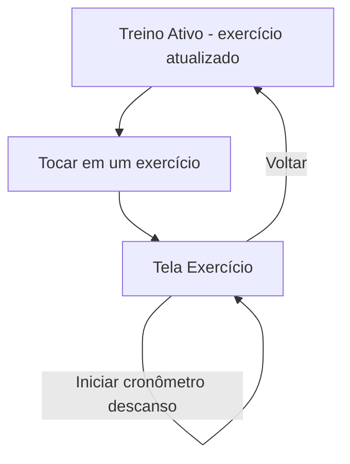

# Tela Exercício

A **Tela Exercício** é onde o usuário registra as séries de um exercício específico durante um treino. É a parte mais tática do aplicativo: carga, repetições, descanso, técnicas avançadas e validação de dados acontecem aqui.

## O que a Tela Exercício faz

- Edita o nome do exercício, a carga de referência e as notas rápidas.
- Adiciona uma nova série com repetições, carga, tempo de descanso e técnicas avançadas.
- Atualiza uma série existente (alterar reps, carga, descanso, técnicas).
- Exclui uma série.
- Aplica ajuste rápido de repetições (`+1`, `-1`, etc.).
- Copia as repetições da última série para os campos de entrada.
- Roda o cronômetro de descanso entre séries.
- Valida os campos antes de adicionar uma série (ex: repetições devem ser maiores que zero).
- Sincroniza notas globais de exercício (a mesma nota aparece para "Supino" em qualquer treino).

## O que a Tela Exercício NÃO faz

- Não gerencia a lista de exercícios do treino (isso é o [Treino Ativo](./treino-ativo.md)).
- Não finaliza ou cancela o treino como um todo (isso é o [Treino Ativo](./treino-ativo.md)).
- Não lista treinos concluídos (isso é o [Histórico](./historico.md)).

## Fluxo do usuário



## Como as peças se coordenam (diagrama de camadas)

O código espalha a responsabilidade entre vários arquivos. Este diagrama mostra quem chama quem quando o usuário interage com a Tela Exercício:

```
View (ExerciseScreen.tsx)
  └─ Pura, sem lógica. Recebe o exercício e callbacks via props de useExerciseScreen.
      │
      ▼ props + callbacks
Container (useExerciseScreen.ts)
  └─ Mantém uma cópia de trabalho do exercício (estado interno).
      │
      ▼ notifica toda alteração
onUpdateExercise(exercício modificado)
  └─ Chamado no pai (Treino Ativo), que atualiza o exercício dentro da sessão ativa no SessionContext.
      │
      ▼ grava quando necessário
Serviço de persistência (storageService.ts)
  └─ Lê e grava notas globais de exercício (chave: meu_treino_global_notes)
```

Essa separação é intencional: nenhum componente recebe props em cascade (prop-drilling é proibido pelo AGENTS.md). Cada camada tem um papel claro e a View nunca sabe que o LocalStorage existe para notas globais.

## O que você vê ao abrir

Ao abrir a Tela Exercício, a tela é composta por:

- **Cabeçalho**: nome do exercício (editável) e carga de referência.
- **Inputs de série**: repetições, carga e tempo de descanso.
- **Técnicas avançadas**: chips para selecionar técnicas (RP, DS, FS, ISO).
- **Botão "Adicionar Série"**: valida os campos e insere a série na lista.
- **Lista de séries**: cada item exibe repetições, carga, descanso e técnicas aplicadas, com botões de edição e exclusão.
- **Botão "Copiar último set"**: preenche os campos com os valores da última série adicionada.
- **Cronômetro de descanso**: conta o tempo de descanso entre séries (zerado e iniciado após adicionar uma série).
- **Seção "Último treino"**: mostra as séries do último treino para esse mesmo exercício, servindo de referência (`LastWorkoutSets`).
- **Notas rápidas**: campo de texto para anotações do exercício, sincronizadas globalmente.

Não aparecem dados de outros exercícios nem do treino como um todo — esses detalhes só são vistos no [Treino Ativo](./treino-ativo.md).

## O container `useExerciseScreen` e o estado interno

O container `useExerciseScreen` consolidou o estado do formulário em uma única fonte de verdade: o exercício de trabalho. Quando o usuário navega para outro exercício, o estado interno é sincronizado com o exercício novo recebido pelo pai.

**Por que um estado interno separado?** A Tela Exercício não grava cada alteração imediatamente no `SessionContext`. Ela mantém uma cópia de trabalho e só notifica o pai via `onUpdateExercise` sempre que algo muda. Isso evita:

1. **Re-renders desnecessários**: toda digitação nos inputs não dispara atualização no estado global da sessão.
2. **Desacoplamento**: a Tela Exercício não sabe nada sobre o treino como um todo; ela apenas recebe um exercício e devolve um exercício modificado.

Todo fluxo de mutação passa por `onUpdateExercise`, que atualiza o exercício dentro da sessão ativa no `SessionContext`.

## Relação com o Treino Ativo

A Tela Exercício é acionada pelo [Treino Ativo](./treino-ativo.md). Toda vez que o usuário modifica algo (adiciona série, muda nome, altera carga), o container chama `onUpdateExercise`, que atualiza o exercício dentro da sessão ativa no `SessionContext`.

Ou seja: a Tela Exercício não sabe nada sobre o treino como um todo; ela apenas recebe um exercício e devolve um exercício modificado.

## Relação com a persistência

A Tela Exercício lê e grava notas globais de exercício via `storageService`:

- `getGlobalExerciseNote(exerciseName)` — recupera a nota salva globalmente para esse nome de exercício.
- `saveGlobalExerciseNote(exerciseName, notes)` — salva a nota, normalizada em minúsculas e sem espaços, sob a chave `meu_treino_global_notes`.

Isso significa que, se o usuário anotar "pescoço neutro" no Supino de um treino, essa mesma nota estará disponível no Supino de qualquer outro treino.

## Validação de campos

Antes de adicionar uma série, o container valida os campos:

- Repetições devem ser maiores que zero.
- Carga deve ser maior que zero.

Se a validação falhar, a série não é adicionada e o usuário é informado (mensagem de erro ou destaque no campo inválido).

## Fluxo típico (em linguagem natural)

1. Dentro do Treino Ativo, o usuário toca em um exercício → abre a Tela Exercício.
2. Vê o nome do exercício, carga de referência e notas.
3. Digita repetições e carga da série, ajusta o descanso se quiser, seleciona técnicas avançadas (ex: "FS" para Feeder Set).
4. Clica em "Adicionar Série" → a série aparece na lista abaixo.
5. Se quiser repetir as repetições da última série, clica em "Copiar último set".
6. Após adicionar a série, o cronômetro de descanso é zerado e começa a contar.
7. Quando termina com o exercício, volta para o Treino Ativo. Todas as alterações já foram salvas na sessão.

## Filosofia de componentização e onde as coisas acontecem

O projeto segue a separação entre componentes de UI (`Mt*`, agnósticos) e componentes de domínio (nomes de treino). Na Tela Exercício isso se reflete assim:

- **`ExerciseScreen.tsx`** — View pura. Não tem lógica: recebe todos os dados e callbacks de `useExerciseScreen` via props. Só renderiza.
- **`ExerciseSetItem.tsx`** — renderiza uma série individual na lista (edição e exclusão de série).
- **`ExerciseList.tsx`** — renderiza a lista de séries do exercício.
- **`ExerciseTechniquePills.tsx`** — chips para selecionar técnicas avançadas (RP, DS, FS, ISO).
- **`LastWorkoutSets.tsx`** — mostra as séries do último treino para esse mesmo exercício (referência).
- **`RestTimer.tsx`** — cronômetro de descanso.

Nenhum componente recebe props em cascade: tudo vem do container `useExerciseScreen`, consumido diretamente pela View.

## Referências cruzadas

- Para o contexto do treino que contém esse exercício, veja [Treino Ativo](./treino-ativo.md).
- Para onde o treino vai ao ser finalizado, veja [Histórico](./historico.md).
- Para o mapa geral do sistema, veja [Visão Geral](./visao-geral.md).

## Ficou de fora?

Assuntos que não couberam aqui:

- Técnicas avançadas detalhadas (o que cada sigla significa e como afeta o descanso).
- Validação de erro quando o formulário está inválido (mensagem de modal).
- Inputs de `equipmentType` e `loadType` (equipamento e tipo de carga).

Se algum desses precisar de documentação própria, é por aqui que começamos.

---

> **Para agentes:** regras de código, convenções e proibições estão em [AGENTS.md](../../AGENTS.md).
